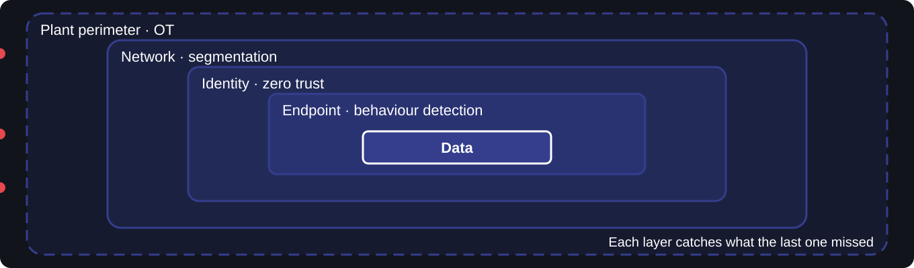

 

We are the **Information Technology team at Forbes Marshall**. We build, run and protect the digital backbone behind steam engineering and control instrumentation, from the shop floor to the cloud.

<!-- Uncomment once public repos exist

| Repository | Purpose |
|---|---|
| [`<repo-name>`](https://github.com/fmadmin-infra/<repo-name>) | <one-line purpose> |
-->

> [!IMPORTANT]
> Found a security issue? Do not open a public issue. Follow our [security policy](https://github.com/fmadmin-infra/.github/blob/main/SECURITY.md).

**Contact:** <dessup@forbesmarshall.com>

